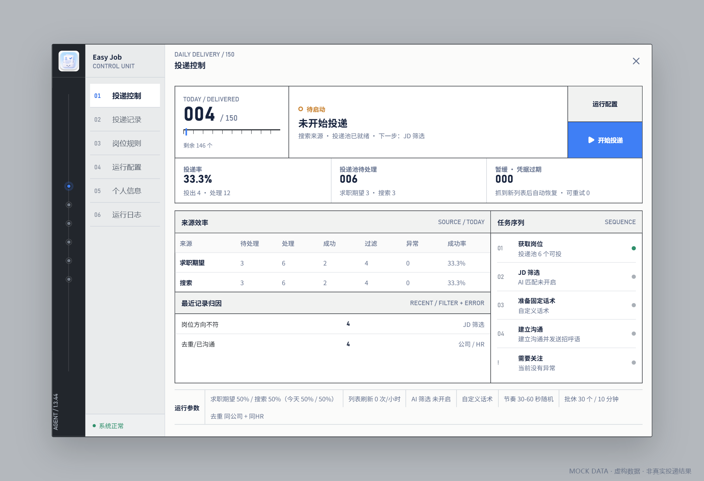
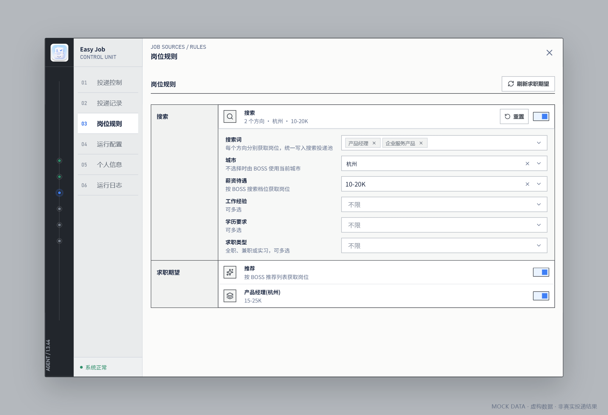
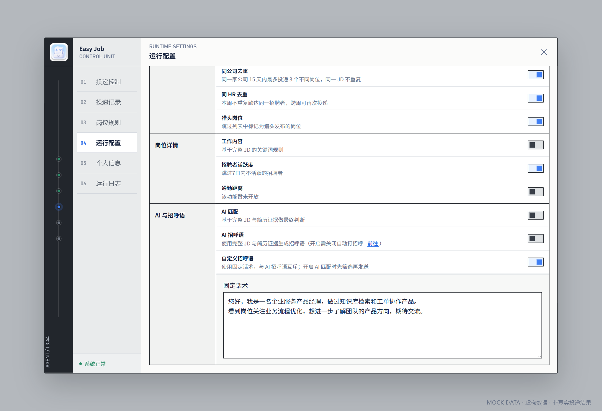
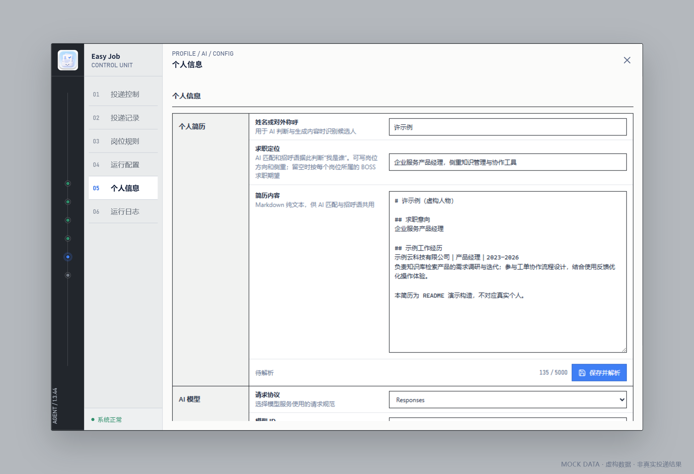
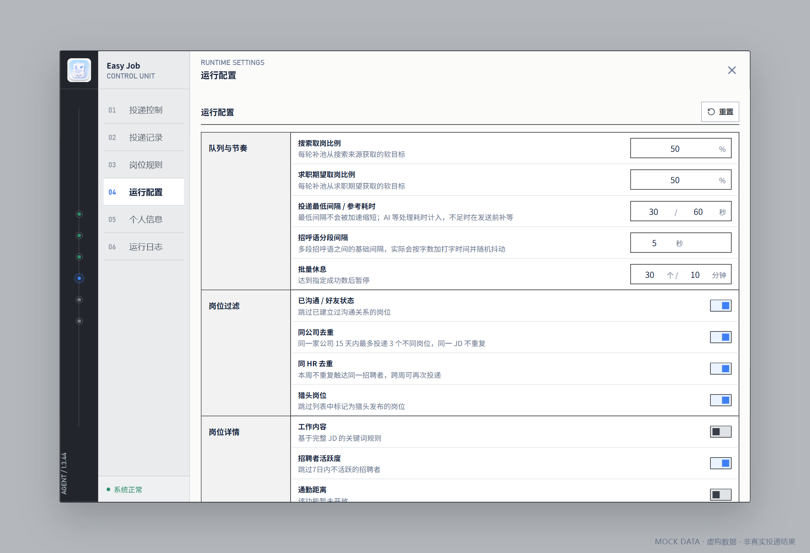
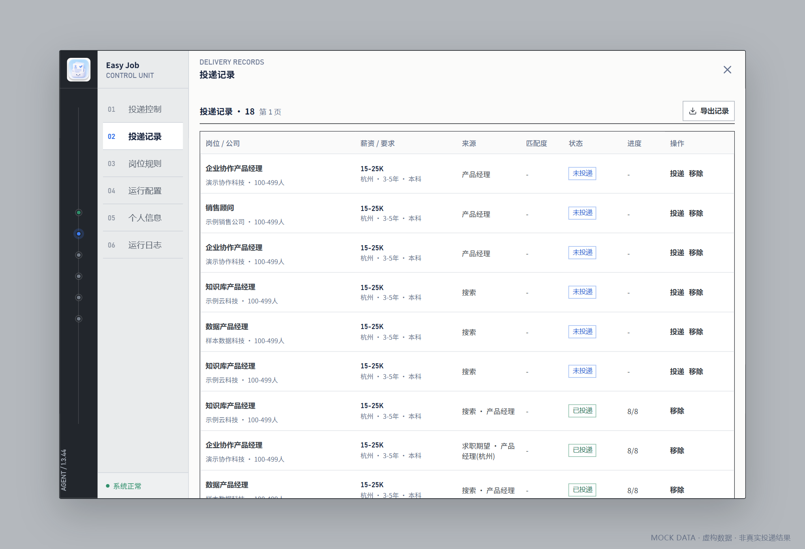
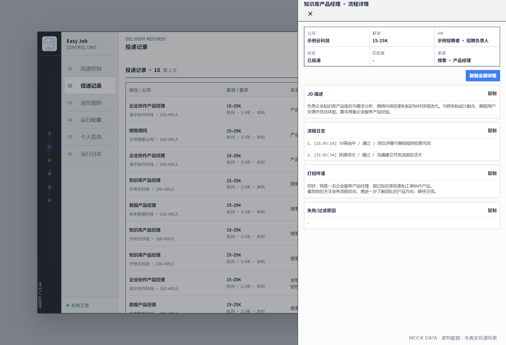

# Easy Job

**在 BOSS 直聘网页里，把找岗位、筛选、打招呼和投递复盘连起来。**

Easy Job 是一个开源浏览器扩展，支持 Chrome、Edge 和 Firefox。你决定找什么工作、哪些岗位不投、用 AI 写招呼语还是发送自己的固定话术，插件按队列执行，并留下可以复核的岗位与运行记录。

[下载最新版本](https://github.com/MarshuPan/easy-job/releases/latest) · [快速开始](#快速开始) · [选择招呼语模式](#选择招呼语模式) · [问题反馈](https://github.com/MarshuPan/easy-job/issues)



> 本文配图由插件实际界面在独立离线环境中渲染，使用虚构岗位、简历、话术和统计数据。图中数字仅用于演示，不代表真实投递效果。

## 能做什么

| 能力           | 你可以怎样用                                                                      |
| -------------- | --------------------------------------------------------------------------------- |
| 双来源获取岗位 | 同时使用多个搜索词和 BOSS 已有求职期望；设置来源比例，统一进入待投递队列。        |
| 基础筛选与去重 | 按已沟通状态、公司、招聘者、猎头标记、招聘者活跃度和 JD 关键词减少无效触达。      |
| AI 岗位匹配    | 结合完整 JD、求职定位和简历证据评估匹配度，保存判断理由；达到你设置的分数才继续。 |
| AI 招呼语      | 针对每份 JD 从真实简历事实中选材，支持分段、目标字数和自定义写作 Prompt。         |
| 自定义招呼语   | 填写固定话术，保留换行、整条发送；可以搭配 AI 筛选，也可以完全不使用 AI。         |
| 投递节奏控制   | 配置最低间隔、参考耗时、分段间隔和批量休息；AI 处理时间计入预算，只补不足的等待。 |
| 暂停与恢复     | 保留队列和任务进度；区分待重试、招呼语待续发和发送结果未知，减少重复操作。        |
| 记录与复盘     | 查看每个岗位的来源、结果、过滤原因、AI 判断和实际话术，导出岗位记录。             |
| 本机完整诊断   | 可选启动 Node 接收器，将运行、岗位、任务、话术与聊天反馈写到本机，方便后续分析。  |
| 本地配置管理   | 简历、模型和配置在本机保存，支持配置导入导出；悬浮入口可自由拖动并记住位置。      |

它帮助你减少重复操作，并把“为什么没投”“发了什么”“卡在哪一步”变成有记录可查的问题。它不承诺回复率或面试邀约，也不绕过平台验证。

## 快速开始

### 1. 安装插件

从 [Releases](https://github.com/MarshuPan/easy-job/releases/latest) 下载对应浏览器的 ZIP，解压到一个长期保留的目录。

| 浏览器  | 下载文件                      | 安装方式                                                                                               |
| ------- | ----------------------------- | ------------------------------------------------------------------------------------------------------ |
| Chrome  | `easy-job-<版本>-chrome.zip`  | 打开 `chrome://extensions` → 开启开发者模式 →「加载已解压的扩展程序」→ 选择含 `manifest.json` 的目录。 |
| Edge    | `easy-job-<版本>-edge.zip`    | 打开 `edge://extensions` → 开启开发人员模式 →「加载解压缩的扩展」→ 选择含 `manifest.json` 的目录。     |
| Firefox | `easy-job-<版本>-firefox.zip` | 打开 `about:debugging#/runtime/this-firefox` →「临时载入附加组件」→ 选择解压目录的 `manifest.json`。   |

三种产物均为 Manifest V3。Firefox 要求 115 ESR 或更高版本，临时载入在浏览器重启后失效，永久安装需要 Mozilla 签名。Chrome、Edge 安装后请保留解压目录。

升级时将新版解压到原安装目录，在扩展管理页重新加载，再重新打开 BOSS 岗位页面。保留原扩展安装即可延续本地配置；卸载扩展可能清除数据，重要配置请先导出备份。

### 2. 选择岗位来源

登录 BOSS 直聘求职者网页，进入岗位页面，点击悬浮 logo 打开面板。按住 logo 可以拖动位置。

在「岗位规则」里设置来源：

- **搜索**：填写一个或多个搜索词，并按需要选择城市、薪资、经验、学历和求职类型。搜索词默认留空，需要自行填写；没有搜索词时不会执行全站搜索。
- **求职期望**：从 BOSS 账号已有的推荐和求职期望中选择要启用的项。修改期望本身需要在 BOSS 侧完成。

搜索条件仅作用于搜索来源，后续运行过滤对两个来源都生效。「运行配置」中的来源比例是补池的软目标，某一来源不足时会结合可用岗位补充，并非各自独立的每日额度。



### 3. 选择筛选和招呼语

在「运行配置 → AI 与招呼语」中选择模式。**AI 招呼语与自定义招呼语互斥，AI 匹配独立开关**，详见下表。

只想发送自己的固定话术时，可以先关闭两项 AI 能力，开启自定义招呼语并填入正文，不需要配置模型或简历。

### 4. 检查节奏，开始投递

在「运行配置 → 队列与节奏」检查最低间隔和批量休息，再到「投递控制」点击「开始投递」。

首次使用先观察一小批：看岗位是否符合预期、过滤理由是否合理、实际发出的文字是否正确，再决定是否继续。需要调整岗位规则、模型或话术时，先暂停并结束当前任务，再修改配置。

## 选择招呼语模式

| AI 匹配 | 招呼语模式       | 执行方式                                         | 需要准备                         |
| ------- | ---------------- | ------------------------------------------------ | -------------------------------- |
| 关闭    | 自定义           | 基础过滤通过后，建立沟通并发送固定话术。         | 固定话术。                       |
| 开启    | 自定义           | 先做 AI 匹配，达到分数后建立沟通并发送固定话术。 | 模型、简历与固定话术。           |
| 关闭    | AI 生成          | 基础过滤通过后，结合 JD 与简历生成话术并发送。   | 模型与个人资料。                 |
| 开启    | AI 生成          | 先做 AI 匹配，再为通过的岗位生成话术并发送。     | 模型与个人资料。                 |
| 任意    | 两种招呼语都关闭 | 按所选筛选规则建立沟通，插件不发送招呼文本。     | 开启 AI 匹配时仍需要模型与简历。 |

基础去重、列表过滤和已启用的详情规则始终执行；关闭 AI 匹配不等于取消所有过滤。两种招呼语开关默认都关闭，配置模型也不会自动开启 AI。

### 自定义固定话术

开启「自定义招呼语」，在文本框填入要发送的内容。插件将完整原文作为一条消息发送，保留换行，不做 AI 改写或分段，也不套用 AI 模式的字数和事实引用规则。开启后必须填写非空正文才能开始投递。



### AI 生成话术

先到「个人信息」完成两项配置：

1. **AI 模型**：填写协议、API 地址、API Key 和模型名称，保存并测试连接。支持 OpenAI Chat Completions、OpenAI Responses 和 Anthropic Messages 协议。首次使用模型地址时，允许浏览器访问你自己配置的地址。
2. **个人资料**：填写对外称呼、求职定位和简历正文，保存并解析简历，形成可追溯的事实证据。没有模型时可以先保存正文，模型可用后再解析。

随后在「运行配置」开启 AI 匹配或 AI 招呼语。三个 AI 任务——简历解析、岗位匹配、招呼语生成——共用你配置的一个模型渠道。项目不提供模型服务或中转服务，调用费用由你选择的提供方决定。

AI 招呼语可以调整消息条数、目标总字数和用户 Prompt。目标字数是整组消息的软目标；项目和事实引用按 JD 与真实证据需要选择，没有固定“最多两条事实”的限制。插件检查事实来源、JD 锚点、逐段引用和主张边界，风格复核会检查模板化、雷同等问题；这些检查不能代替你对内容的判断。

使用插件发送招呼语时，请同时检查 BOSS 自带的「自动打招呼」设置，避免平台话术与插件话术重复发送。



## 投递节奏如何控制

所有招呼语模式共用节奏控制，关闭 AI 后也不会因为处理很快就连续突发投递。

| 设置                    | 含义                                                                                  |
| ----------------------- | ------------------------------------------------------------------------------------- |
| 投递最低间隔 / 参考耗时 | 默认 `30 / 60` 秒。最低值不会被随机等待或会话加速突破，参考耗时用于生成本次处理目标。 |
| 招呼语分段间隔          | 控制 AI 多段消息之间的基础间隔，实际还会结合文字长度调整；自定义话术整条发送。        |
| 批量休息                | 达到配置的成功数量后休息，再继续处理队列。                                            |

每个岗位先完成详情获取、过滤和需要的 AI 处理，再在建立沟通前补等：

```text
补等时间 = max(0, 本次目标耗时 − 本岗已经处理的时间)
```

例如本次目标为 40 秒，处理用了 8 秒，则补等约 32 秒；如果已用了 50 秒，就直接继续。发送后不再重复等待这份时间预算。实际建立沟通的请求还会核对相邻动作的最低间隔，恢复任务和补发也受约束。

本地直接过滤掉的岗位不必完整等待一轮投递预算。平台明确限流时仍执行相应退避；配置时间间隔不代表平台保证不会风控。



## 过滤、队列和恢复

### 过滤哪些岗位

- **已沟通 / 好友状态**：按岗位返回的沟通状态跳过。
- **同公司**：同一家公司 15 天内最多投递 3 个不同岗位，同一 JD 不重复。
- **同 HR**：同一账号、同一招聘者在自然周内成功建立沟通后，本周不再重复触达；下周可重新通过这一项检查。没有可靠日期的旧 ID 不直接当成本周已投。
- **猎头、招聘者活跃度**：根据平台返回的标记和活跃信息判断。
- **工作内容**：按完整 JD 中的关键词执行包含或排除规则。
- **AI 匹配**：开启后按分数门槛决定是否继续，并保存匹配理由。

不同过滤项独立生效。例如 HR 已经跨周，也可能因为“已沟通”或同公司规则被跳过。公司规模有内置判断，当前未开放单独配置；通勤距离功能尚未开放。

### 队列怎样继续

搜索与求职期望共用投递队列，按入队顺序处理，结合剩余岗位、来源供给和凭据状态补池。暂停或刷新后的恢复以持久任务与岗位队列为依据。

“已建立沟通”与“招呼语发送完成”分别记录：已建联但话术未完成的岗位只续发未完成部分，不重复建立沟通；发送结果未知时保留核对状态，不盲目重发。页面需要安全验证或会话失效时会暂停，需在平台完成相应处理后再继续。

## 从哪里查看结果

| 面板分区 | 查看内容                                                                                   |
| -------- | ------------------------------------------------------------------------------------------ |
| 投递控制 | 今日进度、投递率、投递池数量、来源效率、过滤与异常归因、任务序列。这里的投递率不是回复率。 |
| 投递记录 | 岗位来源、匹配度、状态和详情；查看过滤理由、JD、实际招呼语和发送结果，导出记录。           |
| 岗位规则 | 搜索条件、启用的 BOSS 求职期望。                                                           |
| 运行配置 | 来源比例、节奏、基础过滤、详情规则、AI 与招呼语。                                          |
| 个人信息 | 简历、模型、完整配置导入导出。                                                             |
| 运行日志 | 任务启停、补池、过滤摘要、异常和平台限流；诊断模式增加技术细节。                           |





浏览器内岗位记录保留最近 7 天、最多 1,000 条；今天最新 50 条保留 JD 全文和过程记录，其余逐步精简为摘要。界面运行日志保留最新 200 条。**需要长期完整复盘时，使用本机诊断镜像；界面保留窗口不等于本机日志上限。**

### 可选：把完整诊断写入本机

安装 [Node.js](https://nodejs.org/) ≥ 20.19，在本仓库根目录执行：

```bash
node scripts/local-log-sink.mjs
```

开发环境也可执行 `corepack pnpm logs:serve`。接收器只监听 `127.0.0.1:3210`，浏览器保持运行即可接收扩展镜像，文件按日期追加：

```text
data/runtime/
├── logs/        # 运行、AI 请求与节奏诊断
├── deliveries/  # 岗位、过滤判断、JD 与发送结果
├── tasks/       # 投递任务、配置快照与恢复检查点
└── feedback/    # 话术版本、实际发送分段与会话反馈
```

接收器默认永久保留，没有 200 条上限；文件达到大小后只滚动文件。只有显式设置正数 `EASY_JOB_LOG_RETENTION_DAYS` 才按天清理。未启动时事件进入扩展本地持久队列，恢复后补传，不阻塞投递。

检查采集完整性：

```bash
node scripts/audit-local-runtime.mjs
```

完整诊断包含 JD、简历正文、Prompt、模型响应、实际发送文本和聊天反馈；可复用的 API Key、Cookie、令牌等凭据会被拦截。这些文件用于本机溯源，不能直接上传公开仓库或粘贴到公开 Issue。

### 回复率能分析到什么程度

插件会将发送记录与聊天页实际观察到的会话消息关联，保留消息方向、平台时间、实际话术和可关联的对方反馈，用于后续分析回复率、首条回复延迟与话术差异。

这依赖聊天页的实际采集覆盖，不会主动遍历所有历史会话。未采集到反馈不能直接算成“对方没回复”；系统卡片、我方消息、历史重复消息不能冒充新回复，自动回复也不等于有效沟通。当前提供的是诊断与分析数据，不是覆盖所有会话的效果承诺。

## 常见问题

**一定要配置 AI 吗？** 不需要。关闭 AI 匹配，选择自定义话术，就能按基础规则处理队列并发送固定文本。

**为什么过滤了很多岗位？** 先看岗位记录中的具体原因，再区分搜索条件、基础规则、详情关键词和 AI 分数。多个开关同时开启时，不能仅凭“过滤很多”判断哪一项有问题。

**连接测试成功，为什么 AI 任务仍失败？** 连接测试只验证一次最小请求；长简历、结构化输出、模型能力、协议兼容或额度仍可能使实际任务失败，具体原因看运行日志。

**为什么显示等待？** 可能是节奏补等、批量休息、平台退避、模型重试或话术等待发送通道。先看任务状态及对应日志；等待不等于投递成功。

**配置备份里有没有投递记录？** 没有。配置导入导出与岗位记录导出独立，完整配置文件可能包含简历和 API Key，请作为私有备份保管。

## 开发与构建

要求 Node.js ≥ 20.19 与 Corepack，使用 `package.json` 锁定的 pnpm 版本。

```bash
corepack pnpm install --frozen-lockfile
corepack pnpm dev                 # Chrome 开发模式
corepack pnpm dev:edge
corepack pnpm dev:firefox
```

验证与打包：

```bash
corepack pnpm test
corepack pnpm check
corepack pnpm lint
corepack pnpm fmt:check
corepack pnpm verify:public-config
corepack pnpm build               # 三浏览器构建与扩展清单校验
corepack pnpm zip                 # 三浏览器 ZIP 安装包
corepack pnpm validate
```

产物位于 `.output/`。单目标可使用 `build:chrome`、`build:edge`、`build:firefox` 或对应的 `zip:*` 命令。

## 数据与隐私

配置、简历、队列和记录存储在浏览器扩展本地；启用本机接收器后另有一份本机诊断镜像。启用 AI 时，任务所需的简历、岗位与 Prompt 会发送到你自行配置的模型提供方；插件自身不提供云端账户、简历托管或请求中转服务。

请勿将 API Key、Cookie、真实简历、导出的个人配置、运行日志或真实聊天截图提交到公开仓库。反馈问题请使用 mock 数据或经检查的最小复现，并注明版本、浏览器、运行模式与问题步骤。详见 [隐私说明](PRIVACY.md) 和 [安全说明](SECURITY.md)。

## 免责声明

**本项目仅供学习交流，禁止用于商业用途。**

**使用该脚本有一定风险（如黑号、封号、权重降低等），本项目不承担任何责任。**

以上为作者立场声明。本项目以 MIT License 开源，MIT 条款本身不限制商业使用，该声明因此不构成授权限制。选择无视者自行承担由此产生的全部后果，作者不提供任何形式的担保，亦不承担任何责任。

使用自动化投递前，请自行确认招聘平台规则、账号风险、投递节奏及所在地适用的法律法规。因使用本项目导致的账号封禁、数据丢失、法律纠纷或其他损失，均由使用者自行承担。

## License

[MIT](LICENSE)
